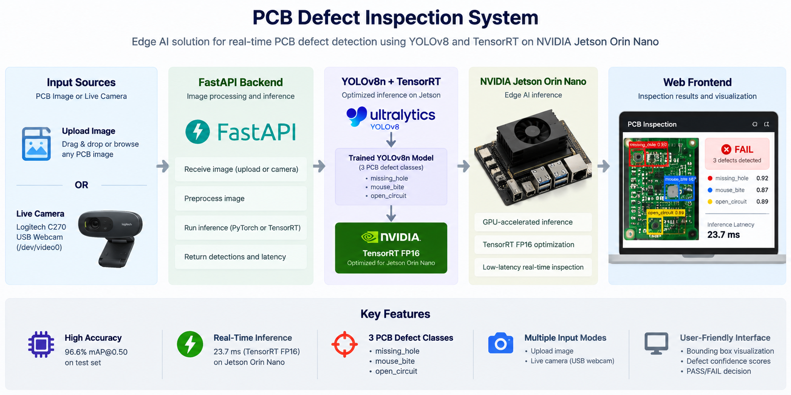
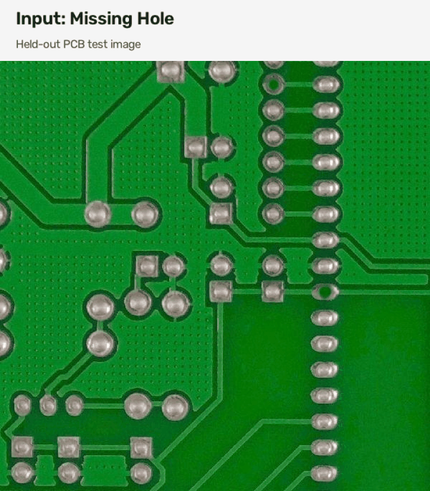
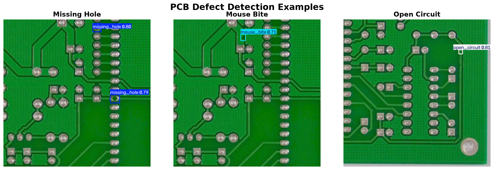
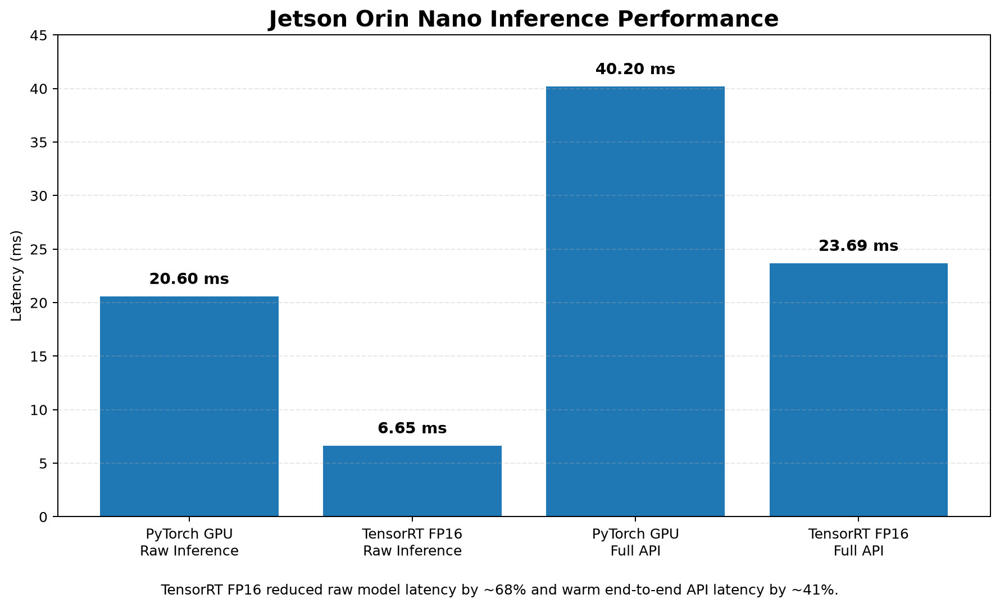

# PCB Edge Inspection

Edge AI system for PCB defect detection and quality inspection using a fine-tuned YOLO object detection model, FastAPI backend, NVIDIA Jetson Orin Nano deployment, and TensorRT FP16 optimization.

<p align="center">
  
</p>

<p align="center">
  <em>End-to-end PCB defect inspection pipeline with image upload, live camera input, FastAPI, YOLOv8n, TensorRT FP16, and NVIDIA Jetson Orin Nano deployment.</em>
</p>

---

## Project Overview

This project develops an end-to-end computer vision system for automated PCB manufacturing defect inspection.

A fine-tuned YOLOv8n model detects manufacturing defects in PCB images. Model predictions are processed by a decision engine that converts raw detections into an application-level inspection result.

The system currently detects three PCB defect classes:

- `missing_hole`
- `mouse_bite`
- `open_circuit`

The backend exposes the inspection pipeline through a FastAPI service so that a frontend application can upload PCB images and receive structured inspection results.

The complete backend has also been deployed on an NVIDIA Jetson Orin Nano Developer Kit using Docker, CUDA, and TensorRT FP16 acceleration.

---

## System Architecture

```text
PCB Image
    ↓
FastAPI Upload Endpoint
    ↓
Fine-Tuned YOLOv8n
    ↓
PyTorch / TensorRT Inference
    ↓
Defect Detection
    ↓
Class + Bounding Box + Confidence
    ↓
Decision Engine
    ↓
FAIL / UNCERTAIN
    ↓
Structured JSON Response
    ↓
Frontend / Operator Interface
```

The architecture separates four responsibilities:

1. **Perception** — detect PCB defects using YOLO.
2. **Optimization** — accelerate inference using TensorRT on NVIDIA Jetson.
3. **Decision making** — convert detections into inspection decisions.
4. **Presentation** — provide structured results to a frontend through an API.

## Demo

The following demo shows the trained PCB defect detector processing representative held-out test images and returning defect classifications, confidence scores, and inspection decisions.

<p align="center">
  
</p>

<p align="center">
  <em>YOLOv8n PCB defect detection on held-out examples for missing_hole, mouse_bite, and open_circuit.</em>
</p>
---

## Dataset

The project uses the **PCB Error Detection** dataset from Roboflow Universe.

Dataset information:

- Workspace: `pcb-error-detection`
- Project: `defect-vtuov`
- Version used: `5`
- License: `CC BY 4.0`
- Task: Object Detection

The dataset itself is not stored in this GitHub repository.

### Defect Classes

The dataset contains three classes:

1. `missing_hole`
2. `mouse_bite`
3. `open_circuit`

### Dataset Split

The downloaded training set contained augmented copies of the original training images.

The final split used for this project is:

| Split | Images |
| --- | ---: |
| Training | 1,938 |
| Validation | 115 |
| Held-out Test | 116 |

The 1,938 training images were generated from **969 unique source training images**, with two generated versions for each source image.

The original validation pool contained 231 images. It was reproducibly divided into validation and test sets using a fixed random seed.

The held-out test set was kept separate from model training and model selection.

### Dataset Limitation

All available training, validation, and test images contain at least one annotated defect.

There are currently **no confirmed defect-free PCB images** in the dataset.

Because of this limitation, the system cannot yet scientifically validate the rule:

```text
No detected defect → PASS
```

A missing detection could represent either:

- a genuinely defect-free PCB, or
- a defect that the model failed to detect.

Therefore, the current backend conservatively returns:

```text
Reliable defect detected
→ FAIL

Only medium-confidence detections
→ UNCERTAIN

No defect detected
→ UNCERTAIN
```

Defect-free PCB images will be needed before a reliable `PASS` decision can be validated.

---

## Model

### Baseline Model

The detector is based on:

```text
YOLOv8n
```

The model was initialized using pretrained YOLO weights and fine-tuned for the three PCB defect classes.

### Training Configuration

| Parameter | Value |
| --- | --- |
| Model | YOLOv8n |
| Epochs | 30 |
| Image size | 416 × 416 |
| Batch size | 8 |
| Training device | CPU |
| Python | 3.11 |
| Random seed | 42 |
| Training images | 1,938 |
| Validation images | 115 |
| Test images | 116 |

The model was trained in the local development environment using CPU-based PyTorch.

---

## Baseline Evaluation Results

### Held-Out Test Results

The selected baseline model was evaluated on the separate 116-image held-out test set.

The test set contained **248 labeled defect instances**.

| Metric | Result |
| --- | ---: |
| Precision | **96.2%** |
| Recall | **95.7%** |
| mAP@0.50 | **96.6%** |
| mAP@0.50:0.95 | **54.9%** |

### Example Held-Out Test Detections

The following examples show predictions from the trained YOLOv8n model on representative held-out test images from all three defect classes.

<p align="center">
  
</p>

<p align="center">
  <em>Representative detections for missing_hole, mouse_bite, and open_circuit from the held-out test set.</em>
</p>

### Per-Class Test Results

| Defect Class | Precision | Recall | mAP@0.50 | mAP@0.50:0.95 |
| --- | ---: | ---: | ---: | ---: |
| `missing_hole` | 98.8% | 93.9% | 97.1% | 60.3% |
| `mouse_bite` | 93.1% | 97.2% | 95.7% | 55.9% |
| `open_circuit` | 96.7% | 96.2% | 96.9% | 48.6% |

The results show strong defect-detection performance across all three classes.

The lower mAP@0.50:0.95 values indicate that exact bounding-box localization is more difficult than determining whether a defect exists and approximately where it is located.

---

## Validation Results

The final validation results were:

| Metric | Result |
| --- | ---: |
| Precision | 97.8% |
| Recall | 96.6% |
| mAP@0.50 | 97.7% |
| mAP@0.50:0.95 | 58.0% |

The relatively small difference between validation and held-out test performance suggests that the detector generalizes well to unseen PCB defect images from the available dataset.

---

## Local Backend Inference Performance

The complete backend pipeline was initially benchmarked on an Intel Core i5-13420H CPU.

A six-run benchmark produced:

```text
Run 1: 2124.68 ms
Run 2:   96.53 ms
Run 3:   35.82 ms
Run 4:   38.52 ms
Run 5:   36.15 ms
Run 6:   35.76 ms
```

Summary:

| Measurement | Latency |
| --- | ---: |
| Cold first inference | 2124.68 ms |
| Average warm latency | 48.56 ms |
| Fastest warm latency | 35.76 ms |
| Slowest warm latency | 96.53 ms |

The large first-request latency is caused by model and runtime warm-up.

Once the model is loaded and warmed up, backend inspection operates in approximately the 36–50 ms range on the development-machine CPU.

The backend loads the YOLO model once when the service starts rather than reloading it for each request.

---

## Project Structure

```text
pcb-edge-inspection/
│
├── data/
│   └── pcb_defects/
│       ├── train/
│       ├── valid/
│       ├── test/
│       └── data.yaml
│
├── models/
│
├── scripts/
│   ├── smoke_test.py
│   ├── split_valid_test.py
│   ├── train.py
│   ├── evaluate.py
│   └── benchmark_backend.py
│
├── src/
│   ├── __init__.py
│   ├── inference.py
│   ├── decision_engine.py
│   ├── backend.py
│   └── api.py
│
├── tests/
│   └── test_decision_engine.py
│
├── Dockerfile.jetson
├── .dockerignore
├── requirements.txt
├── .gitignore
└── README.md
```

Dataset images are excluded from Git tracking.

Generated training outputs and PyTorch model weight files are also excluded from Git tracking.

The TensorRT engine is generated on the target Jetson device and mounted into the application container at runtime rather than being baked into the Docker image.

---

## Python Environment

Recommended local Python version:

```text
Python 3.11
```

Install dependencies using:

```bash
pip install -r requirements.txt
```

Current direct project dependencies:

```text
ultralytics==8.4.184
fastapi==0.162.0
uvicorn==0.54.0
python-multipart==0.0.32
```

---

## Training

Run baseline training from the repository root:

```bash
python scripts/train.py
```

The current training script:

- loads pretrained YOLOv8n weights
- fine-tunes the model for three PCB defect classes
- trains for 30 epochs
- uses 416 × 416 images
- validates during training
- saves the best and final model weights

Model weights and generated training outputs are intentionally excluded from Git tracking.

---

## Evaluation

Run held-out test evaluation using:

```bash
python scripts/evaluate.py
```

The evaluation script loads the selected `best.pt` model and evaluates it using:

```text
split="test"
```

This ensures that final baseline performance is measured using the held-out test set instead of the validation set.

---

## Inference Module

The inference layer is implemented in:

```text
src/inference.py
```

It loads the YOLO model and converts Ultralytics prediction objects into structured Python data.

The model path and inference device can be configured using environment variables:

```text
PCB_MODEL_PATH
PCB_DEVICE
```

The local development environment defaults to:

```text
PCB_DEVICE=cpu
```

The Jetson deployment uses:

```text
PCB_DEVICE=0
```

to explicitly select the NVIDIA GPU.

Example detection:

```json
{
  "class_id": 0,
  "class_name": "missing_hole",
  "confidence": 0.8161,
  "bbox": [
    188.18,
    266.28,
    222.50,
    303.17
  ]
}
```

The inference layer is intentionally separate from application decision logic.

---

## Decision Engine

Inspection decision logic is implemented in:

```text
src/decision_engine.py
```

Current thresholds:

```text
Reliable defect threshold: 0.60
Uncertain threshold:       0.40
```

Current logic:

```text
Confidence >= 0.60
→ FAIL

Confidence >= 0.40 and < 0.60
→ UNCERTAIN

No qualifying detection
→ UNCERTAIN
```

The no-detection case is currently treated as `UNCERTAIN` because the available dataset does not contain verified defect-free PCB images.

The decision engine has independent tests covering:

- reliable defect detection
- low-confidence detection
- no-detection behavior

---

## Unified Backend

The end-to-end inspection pipeline is implemented in:

```text
src/backend.py
```

The backend combines:

```text
Image
   ↓
PCBDefectDetector
   ↓
Structured detections
   ↓
Decision Engine
   ↓
Structured inspection result
```

Example backend result:

```json
{
  "image": "pcb_image.jpg",
  "image_width": 600,
  "image_height": 600,
  "status": "FAIL",
  "reason": "Reliable defect detection(s): missing_hole",
  "defect_count": 1,
  "detections": [
    {
      "class_id": 0,
      "class_name": "missing_hole",
      "confidence": 0.8161,
      "bbox": [
        188.18,
        266.28,
        222.50,
        303.17
      ]
    }
  ],
  "inference_pipeline_ms": 47.26
}
```

---

## Backend API

The backend is exposed through FastAPI.

Start the API locally from the repository root:

```bash
python -m uvicorn src.api:app --reload
```

Available endpoints:

```text
GET  /
GET  /health
POST /inspect
```

### Health Endpoint

Request:

```text
GET /health
```

Example response:

```json
{
  "status": "ok",
  "model_loaded": true
}
```

### Inspection Endpoint

The inspection endpoint accepts an uploaded PCB image:

```text
POST /inspect
```

Supported image formats:

- JPG
- JPEG
- PNG
- BMP

The endpoint returns structured JSON containing:

- original image filename
- image dimensions
- inspection status
- explanation
- number of detected defects
- detected defect classes
- confidence scores
- bounding boxes
- backend pipeline latency

Example:

```json
{
  "image": "pcb_example.jpg",
  "image_width": 600,
  "image_height": 600,
  "status": "FAIL",
  "reason": "Reliable defect detection(s): missing_hole, missing_hole",
  "defect_count": 2,
  "detections": [
    {
      "class_id": 0,
      "class_name": "missing_hole",
      "confidence": 0.8029,
      "bbox": [
        364.47,
        16.64,
        398.23,
        50.59
      ]
    },
    {
      "class_id": 0,
      "class_name": "missing_hole",
      "confidence": 0.7883,
      "bbox": [
        435.38,
        306.82,
        473.42,
        340.37
      ]
    }
  ]
}
```

### Interactive API Documentation

When the FastAPI server is running locally, Swagger documentation is available at:

```text
http://127.0.0.1:8000/docs
```

### Invalid File Handling

Unsupported files are rejected with:

```text
HTTP 400 Bad Request
```

Example response:

```json
{
  "detail": "Unsupported file type. Please upload JPG, JPEG, PNG, or BMP."
}
```

---

## Backend Tests

The decision engine can be tested using:

```bash
python tests/test_decision_engine.py
```

Current tests verify:

- high-confidence defects produce `FAIL`
- medium-confidence detections produce `UNCERTAIN`
- no detections produce `UNCERTAIN`

Additional automated API and inference tests are planned.

---

## NVIDIA Jetson Deployment

The backend was deployed and tested on an **NVIDIA Jetson Orin Nano Developer Kit**.

### Platform

| Component | Configuration |
| --- | --- |
| Device | NVIDIA Jetson Orin Nano Developer Kit |
| Architecture | ARM64 / aarch64 |
| JetPack | 6.2.3 |
| L4T | 36.5.2 |
| Host CUDA | 12.6 |
| Docker | NVIDIA Container Runtime enabled |
| Container base | `nvcr.io/nvidia/pytorch:25.06-py3-igpu` |
| Container PyTorch | `2.8.0a0+5228986c39.nv25.06` |
| TensorRT | 10.11.0.33 |
| Ultralytics | 8.4.184 |

CUDA GPU access was verified from inside the NVIDIA container.

---

## Jetson Docker Image

The optimized deployment image is:

```text
pcb-edge-inspection:jetson-v2
```

The image is built using:

```bash
docker build \
  -f Dockerfile.jetson \
  -t pcb-edge-inspection:jetson-v2 \
  .
```

`Dockerfile.jetson` defaults to:

```text
PCB_MODEL_PATH=/models/best.engine
PCB_DEVICE=0
```

The TensorRT engine is mounted into the container at runtime.

Example deployment:

```bash
docker run --rm \
  --runtime nvidia \
  --ipc=host \
  --ulimit memlock=-1 \
  --ulimit stack=67108864 \
  -p 8000:8000 \
  -v /path/to/best.engine:/models/best.engine:ro \
  --name pcb-edge-api \
  pcb-edge-inspection:jetson-v2
```

The API is then available on:

```text
http://<jetson-ip>:8000
```

Health check:

```bash
curl http://127.0.0.1:8000/health
```

Expected response:

```json
{
  "status": "ok",
  "model_loaded": true
}
```

---

## TensorRT Optimization

The trained YOLOv8n PyTorch model was exported to an **FP16 TensorRT engine** directly on the Jetson Orin Nano.

Export configuration:

| Parameter | Value |
| --- | --- |
| Source model | `best.pt` |
| Export format | TensorRT engine |
| Precision | FP16 |
| Image size | 416 × 416 |
| Batch size | 1 |
| Target device | Jetson Orin Nano GPU |

The generated engine:

```text
best.engine
```

was approximately 8.7 MB.

The TensorRT build was performed on the target Jetson hardware so that the engine was generated for the deployment environment.

---

## PyTorch vs TensorRT Prediction Validation

TensorRT FP16 predictions were compared against the original PyTorch model using representative held-out images from all three defect classes.

### Confidence Comparison

| Defect | PyTorch | TensorRT FP16 | Difference |
| --- | ---: | ---: | ---: |
| `missing_hole` #1 | 0.8029 | 0.8032 | +0.0003 |
| `missing_hole` #2 | 0.7883 | 0.7879 | -0.0004 |
| `mouse_bite` | 0.7124 | 0.7138 | +0.0014 |
| `open_circuit` | 0.8088 | 0.8081 | -0.0007 |

All tested images retained the same predicted defect class.

Bounding boxes were also nearly identical between PyTorch and TensorRT.

These representative checks indicate that FP16 conversion preserved prediction behavior while significantly improving inference performance.

A full held-out TensorRT evaluation remains a useful future extension if exact metric-level equivalence across the complete test set is required.

---

## Jetson Performance Benchmark

### Raw YOLO Inference

For the same representative PCB image:

| Backend | Raw inference latency |
| --- | ---: |
| PyTorch GPU | ~20.60 ms |
| TensorRT FP16 | ~6.65 ms |

TensorRT produced approximately:

```text
3.1× faster raw model inference
~68% lower raw inference latency
```

### End-to-End FastAPI Pipeline

Ten warm API requests were measured using the same image and Jetson device.

#### PyTorch GPU Backend

Warm request latencies:

```text
50.45 ms
39.63 ms
38.63 ms
39.90 ms
40.22 ms
42.68 ms
42.69 ms
35.08 ms
36.22 ms
36.45 ms
```

Average:

```text
40.20 ms
```

#### TensorRT FP16 Backend

Warm request latencies:

```text
26.97 ms
23.02 ms
21.91 ms
23.59 ms
23.45 ms
22.22 ms
23.51 ms
22.29 ms
27.17 ms
22.81 ms
```

Summary:

| Measurement | TensorRT FP16 |
| --- | ---: |
| Average | 23.69 ms |
| Median | 23.24 ms |
| Fastest | 21.91 ms |
| Slowest | 27.17 ms |

### End-to-End Improvement

| Backend | Average warm API latency |
| --- | ---: |
| Jetson PyTorch GPU | 40.20 ms |
| Jetson TensorRT FP16 | 23.69 ms |

### Performance Visualization

<p align="center">
  
</p>

<p align="center">
  <em>TensorRT FP16 reduced raw inference latency by approximately 68% and warm end-to-end API latency by approximately 41%.</em>
</p>

TensorRT therefore achieved approximately:

```text
1.70× faster end-to-end backend execution
~41% reduction in warm API latency
```

The first request after starting a fresh container incurs a substantially larger cold-start cost.

Observed cold requests were approximately:

```text
PyTorch API:   ~3.45 s
TensorRT API:  ~2.82 s
```

Warm-request latency is therefore the more representative measurement for a continuously running inspection service.

---

## Deployment Validation

The final `jetson-v2` deployment was validated end-to-end using the TensorRT FP16 engine.

Example held-out `open_circuit` response:

```json
{
  "image": "l_light_01_open_circuit_14_2_600_jpg.rf.bc80119d8c20aba52ac90da53dd40e0d.jpg",
  "image_width": 600,
  "image_height": 600,
  "status": "FAIL",
  "reason": "Reliable defect detection(s): open_circuit",
  "defect_count": 1,
  "detections": [
    {
      "class_id": 2,
      "class_name": "open_circuit",
      "confidence": 0.8081,
      "bbox": [
        470.76,
        123.37,
        485.29,
        140.52
      ]
    }
  ],
  "inference_pipeline_ms": 2826.61
}
```

The latency shown above corresponds to the first cold request after container startup. Warm TensorRT requests operate around the benchmarked 23.69 ms average.

Representative held-out examples of all three classes were successfully processed through the optimized deployment:

- `missing_hole`
- `mouse_bite`
- `open_circuit`

---

## Backend Progress

- [x] GitHub repository created
- [x] project structure created
- [x] isolated Python environment created
- [x] dataset downloaded and inspected
- [x] dataset class distribution inspected
- [x] augmentation structure identified
- [x] reproducible validation/test split created
- [x] dataset configuration verified
- [x] YOLO inference smoke test completed
- [x] one-epoch training dry run completed
- [x] full YOLOv8n training completed
- [x] held-out baseline evaluation completed
- [x] production inference module
- [x] configurable inference device
- [x] decision engine
- [x] structured backend response
- [x] FastAPI backend interface
- [x] invalid upload handling
- [x] basic decision-engine tests
- [x] local backend latency benchmark
- [x] NVIDIA Jetson environment verified
- [x] Docker deployment created
- [x] YOLO model deployed on Jetson GPU
- [x] TensorRT FP16 model export
- [x] PyTorch vs TensorRT comparison
- [x] Jetson API latency benchmark
- [x] three-class TensorRT prediction validation
- [x] final TensorRT FastAPI deployment
- [ ] automated API tests
- [ ] defect-free PCB validation
- [ ] frontend integration

---

## Current Status

The complete backend and edge-deployment pipeline is operational:

```text
PCB Image
    ↓
FastAPI
    ↓
YOLOv8n TensorRT FP16
    ↓
NVIDIA Jetson Orin Nano GPU
    ↓
Structured Defect Detection
    ↓
Decision Engine
    ↓
FAIL / UNCERTAIN
    ↓
JSON Response
```

The project currently provides:

- fine-tuned PCB defect detection
- three supported defect classes
- held-out model evaluation
- structured bounding-box and confidence output
- conservative quality-inspection decision logic
- FastAPI image-upload service
- upload validation
- latency measurement
- interactive Swagger API documentation
- Docker-based Jetson deployment
- explicit NVIDIA GPU selection
- TensorRT FP16 acceleration
- PyTorch vs TensorRT performance comparison
- representative TensorRT validation across all three classes

The Jetson deployment reduced average warm end-to-end backend latency from approximately **40.20 ms with PyTorch GPU inference to 23.69 ms with TensorRT FP16**, while preserving nearly identical predictions on the representative held-out samples tested.

---

## Remaining Work

The primary remaining development tasks are:

1. Build the frontend/operator interface.
2. Integrate the frontend with the `/inspect` FastAPI endpoint.
3. Add automated API tests.
4. Add verified defect-free PCB images so that a scientifically supported `PASS` decision can be introduced.
5. Optionally evaluate the TensorRT engine across the complete held-out test set.
6. Extend performance analysis with additional edge metrics if needed, such as sustained throughput, power consumption, and resource utilization.

---

## Key Result

The project demonstrates an end-to-end edge AI workflow:

```text
Dataset
    ↓
YOLO Fine-Tuning
    ↓
Held-Out Evaluation
    ↓
Inspection Decision Engine
    ↓
FastAPI Backend
    ↓
Docker Deployment
    ↓
NVIDIA Jetson Orin Nano
    ↓
TensorRT FP16 Optimization
    ↓
Low-Latency Edge Inference
```

The final optimized Jetson backend achieved approximately **23.69 ms average warm end-to-end inference pipeline latency**, compared with **40.20 ms using the PyTorch GPU backend**, while maintaining effectively equivalent predictions on representative held-out examples from all three PCB defect classes.